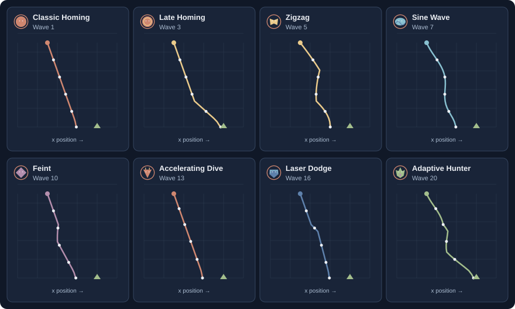

#  Space Invaders

A Space Invaders game implementation using the `ai-game-framework` (version 1.3.0 or newer).
Template for the student groups: fork this repository and develop your agent on top of it.
Documentation: <https://detiuaveiro.github.io/ai-space-invader-template/>

## Features
- Real-time backend server.
- Web-based viewer with Canvas API.
- Dummy agent (random walker/shooter).
- Manual agent (terminal-based A/D/Space control).
- Reproducible runs with `--seed`.
- Three alien attack difficulty modes with `--difficulty`.

## Game Rules and Difficulty
- The player moves one cell West or East per action and shoots a laser (0.5 s cooldown).
- A diving alien that touches the player costs a life and resets the score to the last checkpoint.
- A diving alien that reaches the bottom costs 10 points (never below the checkpoint).
- Clearing a wave gives 100 points, sets a checkpoint and starts a harder wave.
- Difficulty grows with the wave and the score:
  - dive speed: 11 up to 18 (+0.5 per wave, +0.01 per point);
  - time between dives: 2.2 s down to 0.8 s (-0.2 s per wave, -0.005 s per point);
  - simultaneous divers: 1, plus one every two waves, up to 4;
  - from wave 3 the squad has three rows (15 aliens).

### Difficulty Modes

The `--difficulty` option controls which alien attack patterns are available:

- `classic` (default): original homing behavior only.
- `progressive`: gradually unlocks additional attack patterns as waves advance.
- `hardcore`: all eight attack patterns are available from wave 1.

| Alien | Attack pattern | Progressive unlock wave | Description |
|:---:|---|---:|---|
|  | Classic Homing | 1 | Tracks the player above y = 3, then locks onto the last target. |
|  | Late Homing | 3 | Tracks the player closer to the ground. |
|  | Zigzag | 5 | Alternates horizontal movement during the dive. |
|  | Sine Wave | 7 | Uses an oscillating trajectory. |
|  | Feint | 10 | Performs a deceptive lateral maneuver. |
|  | Accelerating Dive | 13 | Accelerates during the dive. |
|  | Laser Dodge | 16 | Reacts to lasers with evasive movement. |
|  | Adaptive Hunter | 20 | Combines advanced attack behaviors. |

Previously unlocked patterns remain available. Pattern selection uses the seeded random number generator. The viewer state includes pattern metadata for rendering; whether agents receive it depends on server routing. Wave- and score-based difficulty scaling applies in all modes.

### Attack trajectories



Example trajectories generated using the Epic Edition `Alien.update()` physics at 30 FPS, with a moving player and an approaching laser for the two evasive patterns. White dots mark every five simulation steps; the green triangle marks the final player position. Paths depend on player movement, laser positions and dive speed; these are examples, not fixed routes.

## Setup & Running the Game

### 1. Prerequisites
- Python 3.10+ installed on your host.

### 2. Create and Activate Virtual Environment
Create a virtual environment (`venv`) to isolate dependencies:
```bash
python3 -m venv venv
source venv/bin/activate
```

### 3. Install Dependencies
Install the project and its dependencies (declared in `pyproject.toml`: `ai-game-framework`, `numpy`, `websockets`):
```bash
pip install -e .
```

### 4. Run the Game Server
Start the backend server (which also serves the frontend web viewer):
```bash
python3 -m server.server
```
Options (`python3 -m server.server --help`):

| Option | Default | Meaning |
|---|---|---|
| `--host`, `-H` | `0.0.0.0` | Address to bind |
| `--port`, `-p` | `8765` | Port of the viewer and of the WebSocket (`/ws`) |
| `--seed`, `-s` | none | Seed of the numpy random generator; without it the seed comes from system entropy |
| `--fps`, `-f` | `30` | Simulation frames per second |
| `--difficulty` | `classic` | Attack pattern mode: `classic`, `progressive`, or `hardcore` |

With a fixed seed, difficulty mode, and identical actions and simulation timing, runs are reproducible.

Run the server with your preferred difficulty mode:

```bash
# Classic (original attack pattern)
python3 -m server.server --difficulty classic

# Progressive (gradually unlocked attack patterns)
python3 -m server.server --difficulty progressive

# Hardcore (all attack patterns from wave 1)
python3 -m server.server --difficulty hardcore

# Reproducible progressive experiment
python3 -m server.server --difficulty progressive --seed 42
```

### 5. Open the Viewer
Open your web browser and navigate to:
```
http://localhost:8765/
```

### 6. Run the Agents
In a separate terminal (ensure the virtual environment is activated):

- **Dummy Agent**:
  ```bash
  python3 -m agents.dummy_agent [--seed N] [--uri ws://localhost:8765/ws]
  ```

- **Manual Agent (Terminal A/D/Space control)**:
  ```bash
  python3 -m agents.manual_agent
  ```

## Development
The project structure:
- `server/`: Game logic, server implementation, and visualizer assets (inside `server/viewer/`).
- `agents/`: Autonomous and manual agent implementations.
- `tests/`: Game unit tests.

## Group Identification
Fill in before submitting.

| Number | Name | E-mail |
|---|---|---|
| | | |
| | | |
| | | |

- Group number:
- Course and academic year:

## Agent Architecture
Fill in: describe the agent your group built. Keep each answer short and concrete.

### 1. Overview
- Type of agent (reactive, model-based, goal-based, utility-based, learning, hybrid) and why:

### 2. Perception
- Which fields of the state does the agent use (`player_x`, `aliens`, `lasers`, `valid_actions`, ...)?
- Derived features (distances, danger zones, predicted alien positions, ...):

### 3. Decision Making
- Algorithm (rules, search, heuristics, evolved controller, ...):
- Priorities when goals conflict (dodge, shoot, reposition):

### 4. Actions
- How the agent chooses between `move WEST`, `move EAST`, `shoot` and doing nothing:

### 5. Parameters and Training (if any)
- Tuned or learned parameters, method, seed used (`--seed`):

### 6. Results
| Seed | Waves cleared | Final score | Lives lost |
|---|---|---|---|
| | | | |

### 7. Limitations and Future Work
-

### 8. Run Instructions
```bash
python3 -m agents.<your_agent>
```
